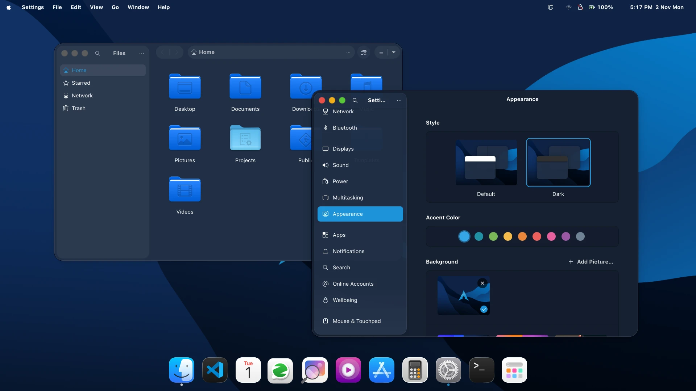
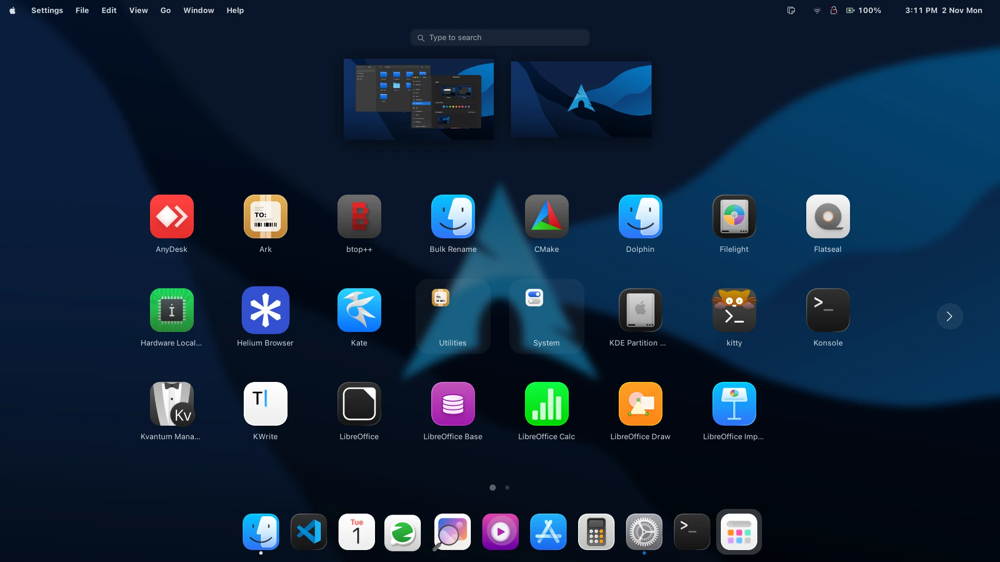
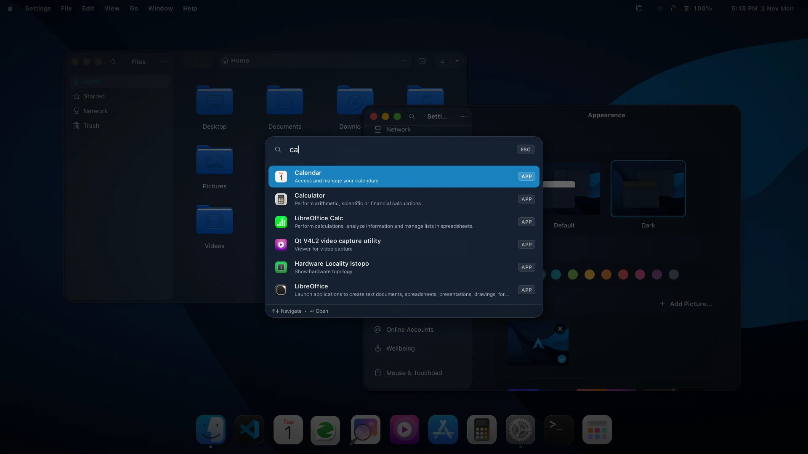

<div align="center">

# GNOME Theme

**A dark, macOS-style look for GNOME.**<br>
Colours, window controls, icons, cursors, dock, menu bar and behaviour. No apps installed.

[](https://github.com/anil0403/gnome-theme/releases/latest)


[](LICENSE)



</div>

## Features

| | |
|---|---|
| 🎨 **Look** | `MacTheme-Dark` for GTK 3, GTK 4, libadwaita and GNOME Shell, with blue accents, MacTheme icons and cursors, and SF Pro fonts |
| 🚦 **Traffic lights** | Larger 20px buttons on the left of the title bar, in GTK, Qt and Flatpak apps |
| ⚓ **Dock** | A bottom dock with hidden trash. Click a focused app to minimize it |
| 🍎 **Menu bar** | A global menu, Activities hidden, and a `3:45 PM  2 Nov Mon` clock |
| 🔍 **Spotlight** | Search apps and settings from anywhere |
| 📋 **Clipboard** | A clipboard history you can paste from |
| 🌌 **Blur** | Blurred Overview and app folders |
| 🖼️ **Wallpaper** | A dark Arch Linux wallpaper on the desktop and lock screen |

<table>
  <tr>
    <td></td>
    <td></td>
  </tr>
  <tr>
    <td align="center">App grid</td>
    <td align="center">Spotlight search</td>
  </tr>
</table>

### Shortcuts

| Keys | Action |
|---|---|
| `Super` `Alt` `F` | Spotlight |
| `Super` `Alt` `Space` | Clipboard history |
| `Print` or `Shift` `Super` `S` | Screenshot |
| `Alt` + drag | Move a window |
| `Alt` + right-drag | Resize a window |
| Middle-click a title bar | Send the window to the back |

## Install

You need `git`, `patch`, `python3` and the User Themes extension, which comes in
your distro's `gnome-shell-extensions` package.

```bash
curl -fsSL https://raw.githubusercontent.com/anil0403/gnome-theme/main/bootstrap.sh | bash
```

Then log out and back in. Prefer to read it first? Clone the repo and run
`./install.sh`.

<details>
<summary>What the installer changes</summary>

- It works per user and installs the latest release. The extensions and icons
  come from their original projects at pinned commits. See
  [THIRD_PARTY.md](THIRD_PARTY.md).
- It sets the wallpaper and leaves your favourites alone.
- It disables Dash to Dock, Ubuntu Dock, Blur My Shell, Just Perfection, Global
  Menu and Kimpanel, because they conflict with this theme.
- **Qt apps:** if `qt6ct` or Kvantum is missing, it installs them with pacman,
  apt or dnf, which asks for your password. This is the only step that needs
  root. The Qt title-bar buttons come from a prebuilt plugin for the current Qt
  on Arch, Fedora, Debian and Ubuntu. On other Qt versions, Qt apps keep their
  own title bars.
- **Flatpak apps:** it gives every Flatpak app read-only access to the theme, and
  gives Qt apps on the KDE 6.10 and 6.11 runtimes the title-bar plugin. Run the
  installer again after installing a new Qt Flatpak app.
- **Fonts:** Apple's license doesn't allow sharing SF Pro and SF Mono, so if you
  don't have them, it downloads them from [Apple](https://developer.apple.com/fonts/)
  (about 220 MB, needs `7z` and `cpio`). If that fails, your current fonts are
  kept.

</details>

## Update

Run the install command again. Your installed version is in
`~/.local/state/gnome-theme/version`, and [VERSIONING.md](VERSIONING.md) explains
the release numbers.

## Uninstall

```bash
~/.local/state/gnome-theme/uninstall.sh
```

This removes what was installed and restores the files and settings it replaced.

## Not included

Apps and app configs (terminal, editor and browser themes) and the GDM login
screen.

## License

MIT, except for the parts listed in [THIRD_PARTY.md](THIRD_PARTY.md), which keep
their own terms.
